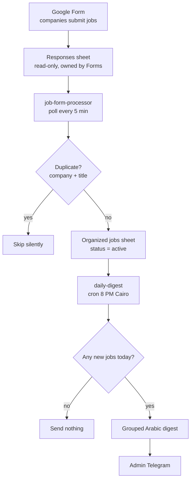

# HR Service Job System

## Project status and evidence

**Requested build.** Requested by a real client but not delivered. No go-live, payment or audience-outcome claim.

**My contribution:** Prepared deterministic form-to-sheet intake and grouped digest workflow artifacts.

**Verification:** Workflow files and setup documentation exist; Moamen confirmed the request was real.


A no-code intake and daily-digest pipeline for a jobs board. Companies submit openings through a Google Form; n8n deduplicates and organizes them in Google Sheets and sends the admin one clean Arabic digest on Telegram every evening. Built for an Egyptian recruitment service that runs several WhatsApp job groups and needed to stop managing postings by hand.


## The problem

Running job groups by hand does not scale: postings arrive in DMs and comments, the same opening gets shared twice, and someone has to compile "today's jobs" manually every night. The admin wanted submissions in one structured place, duplicates removed automatically, and a ready-to-forward daily summary, without a WhatsApp API and without paying for AI in phase one.

## What it does

- Companies submit jobs through a structured Google Form (field, city, job type, salary, contact).
- `job-form-processor` polls the form responses every 5 minutes, trims and normalizes each entry, and appends it to an organized sheet.
- Duplicate guard: same company AND same job title (case-insensitive, trimmed) is skipped silently, no error, no noise.
- `daily-digest` runs at 8 PM Cairo, groups the day's new jobs by field in a fixed order, and sends one Arabic Telegram message. If there were zero new jobs, it sends nothing.

## Architecture



## Design choices

- **No WhatsApp API.** Intake is a Google Form, output is Telegram, both free and reliable, which sidesteps WhatsApp Business API cost and approval for phase one.
- **Sheets as the source of truth.** The organized tab is append-only; a job is expired by editing its status by hand, so nothing is ever destroyed by automation.
- **Arabic-first output.** All admin-facing text is Egyptian Arabic; the digest groups by field in a fixed, predictable order and omits empty fields.
- **Header-name binding.** n8n reads columns by header text, not position, so re-ordering form fields does not break the flow.

## Stack

n8n, Google Forms, Google Sheets, Telegram. No LLM in phase one (AI classification is a documented phase-two option on the free Gemini tier).

## Repository layout

```
workflows/    job-form-processor.json + daily-digest.json (import-ready, placeholders for IDs)
docs/         setup-guide.md (zero-to-running) + sheet-structure.md (schema + digest format)
```

## Run it

1. Stand up n8n (Docker compose in [docs/setup-guide.md](docs/setup-guide.md)) and create the two credentials with the exact names the workflows expect.
2. Build the Google Form and the organized sheet from [docs/sheet-structure.md](docs/sheet-structure.md).
3. Import both workflows, then replace `YOUR_SPREADSHEET_ID` and `YOUR_ADMIN_CHAT_ID` and re-link credentials. No secret is committed; IDs and tokens live in n8n credentials.
4. Run the three tests in the setup guide (form to sheet, duplicate detection, digest).

## Status

Requested by a real client, but not delivered. Existing files are implementation artifacts, not handover or deployment evidence. Published as a reusable Arabic jobs-intake template.

## License

MIT, see [LICENSE](LICENSE).
